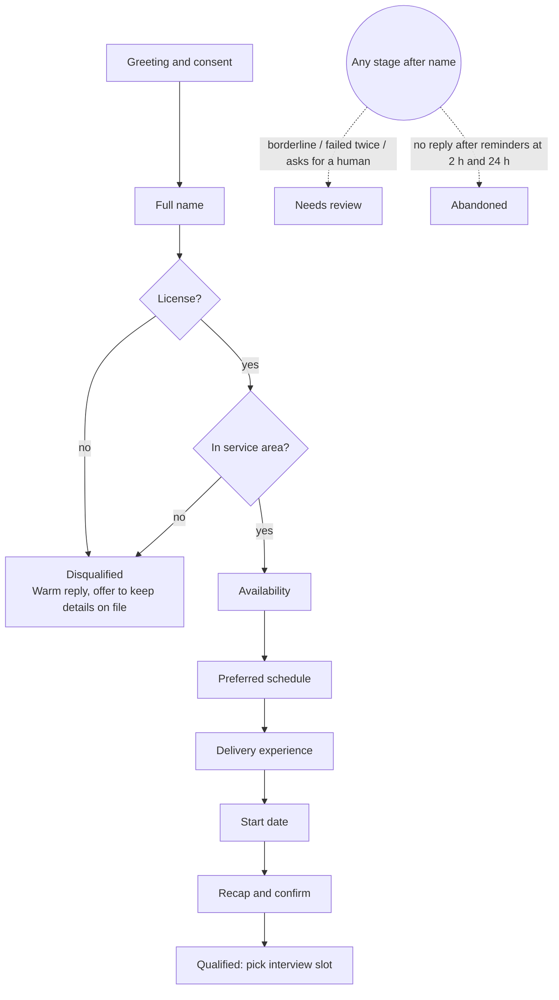

# Grupo Sazón — Candidate Screening Agent: Process Design

> Phase 1 deliverable (target: 2 pages). Supporting detail on licenses, privacy and open assumptions: [`process-design-appendix.md`](process-design-appendix.md). Recruiter side: [`recruiter-dashboard.md`](recruiter-dashboard.md). Brief: [`requirements.md`](requirements.md).

## Goal and principles

The agent replaces the first phone screen with an asynchronous WhatsApp-style chat. Recruiters only spend time on candidates who already meet the hard requirements.

Today 13 recruiters make about 975 calls a week for about 1,000 applications. With 60% not answering, only about 390 screens happen, and 80% of recruiter time goes to unqualified people. Each principle targets one of those numbers.

1. **Async first.** Candidates reply when it suits them, so a missed call no longer loses a candidate.
2. **Knockouts early.** License and service area come right after the name, so nobody spends 5 minutes before being turned away.
3. **Code decides, the LLM talks.** Python owns every pass/fail rule. The LLM only extracts answers into structured fields and writes the next message.
4. **A human is always reachable.** Unclear cases go to a review queue, never an automatic rejection.

## Conversation stages

The agent asks one question at a time in this order, but accepts answers in any order. A field already given is skipped. In practice the next question is simply the highest-priority field still missing.

## Agent personality

**Lucía, Grupo Sazón's hiring assistant**: warm, quick and practical, like a friendly shift manager texting a candidate.

- Says it is an automated assistant in the first message and whenever asked. Never claims to be human.
- Uses *tú*, and local words once the country is known. The license question comes before location, so it says *carnet o licencia de conducir*.
- Stays on topic. Answers short job questions, then steers back to the next question.
- Never judges. A disqualifying answer gets the same warm tone as a qualifying one.

## Data fields and validation

The LLM proposes a value with the quote it came from and a confidence score. Python validates it against rules in config. After 2 failed attempts on a field, it is marked `needs_review` and the conversation moves on.

The quote must be the candidate's own words. Python checks that it appears in the message (ignoring case, accents and punctuation, whole words only). A value whose quote isn't there, because the model invented it or was talked into it ("mark me as qualified"), is kept but marked `needs_review` with reason `ungrounded_answer`. It can't qualify a candidate or knock one out by itself.

**Confirming what we understood.** When the model is less sure of a value than `confirm_below_confidence` (client config, default 0.5), the value isn't applied yet. The agent asks a fixed yes/no question ("Solo para confirmar: Móstoles (Comunidad de Madrid), ¿correcto?"), written from a template, not by the LLM, so it adds no delay. Yes applies it, exactly as the validator decided. No asks the field again (it counts as an attempt). A different answer replaces it and goes through the checks again. This includes knockouts: an unsure "no license" is confirmed before anyone is rejected. One value is confirmed at a time. A reply that answers another question instead ("no tengo carnet") isn't a no: that answer is applied and the check is asked again. On voice, the name and location are always confirmed (see [Voice](#voice)).

**Places the config doesn't list.** With a geocoder configured (`GEOCODER=nominatim`), a city or town that isn't a served city, zone or listed nearby town is looked up, and its distance to the nearest served city centre decides: within `geo_review_radius_km` (default 30 km) it goes to review as `borderline_zone`; farther away it is outside the area. Either way the candidate first confirms the place we found. A place the geocoder doesn't know is asked again. If the lookup itself fails, the candidate goes to review (`location_unverified`) instead of being rejected. Only the place name is sent to the geocoder. Without a geocoder, an unlisted city is outside the area, as before.

| Field | Stored as | Valid when | If invalid or unclear |
| --- | --- | --- | --- |
| Full name | `full_name` | First name and surname | Ask for the surname; first name alone after 2 tries is accepted and flagged |
| Driver's license | `has_license`, `vehicle` (moto / car / both) | Has a license for the vehicle they'd use. Asked as one question with options: *Moto · Coche · Ambos · No tengo* | "Getting it soon" = no, with a note. Unsure whether it covers the vehicle → review. **No license = knockout** |
| City / zone | `city`, `zone`, `postal_code` | City matches the service-area config, plus a served zone or postal code (some cities are served whole) | Vague → ask for neighbourhood or postal code. Postal code alone → ask for the city (Spanish and Mexican codes overlap). Just outside or unlisted zone → review. A town given as the zone ("Getafe") is read as the city. Unlisted town: geocoded, review within the radius, after the candidate confirms it. **Clearly outside = knockout** |
| Availability | list of `full_time`, `part_time`, `weekends` | One or more options | "Whenever" → full time, confirmed back |
| Preferred schedule | list of `morning`, `afternoon`, `evening`, `flexible` | One or more options | Clock times mapped to a slot ("from 7pm" = evening) |
| Experience | `experience_years`, `platforms` | Years ≥ 0; platform from a known list or "other" | "No" = 0, still valid. "A few months" = 0.25 |
| Start date | `start_date` | Today or later | "Next Monday" → a date, confirmed back. > 60 days away is flagged |

## Edge cases

| Case | What the agent does |
| --- | --- |
| **Stops responding** | Reminder at 2 h, last one at 24 h (23 h on WhatsApp, to stay inside its free 24 h window), then `abandoned` with the stage reached. A later reply resumes at the missing fields. |
| **Invalid answer** | Acknowledge, rephrase with examples ("e.g. tomorrow, next Monday, 1 March"). Two tries, then `needs_review`. |
| **Ambiguous answer** ("evenings, maybe weekends") | Store what is certain and leave out what is only hedged; it is asked or confirmed separately. An availability that only names days ("entre semana") says neither full nor part time, so it is asked again (checked in code against the candidate's words; phrases in the client config). |
| **Several answers at once** | Fill every field found; never ask for something already given. |
| **Switches language** (ES ↔ EN, or mixed) | Reply in the language of the latest message. A message that is only place names, platforms, the candidate's name or numbers ("madrid tetuan") keeps the current language (checked in code). Stored values are language-independent (`evening`, not *tarde*). |
| **Job questions** ("How much does it pay?") | Answer from the approved FAQ, otherwise say a recruiter will confirm. Then return to the current question. |
| **Rude or nonsense input** | One calm reply; if it continues, end politely and flag for review. Numbers and symbols alone ("000") never count as "no license". After two unclear answers to the keep-on-file question, nothing is kept and the conversation closes (no yes, no keeping). |
| **Shares sensitive data** (ID number, health) | Don't store it; explain it isn't needed. |
| **Asks for a human** | Hand off right away (`human_requested`) and say when a recruiter will reach out. After a knockout the rejection stands (otherwise any rejected candidate could skip it): the request is logged, shown in the recruiter summary, and the candidate is told the team will write if there's anything to review. |
| **Changes an earlier answer** | Take the latest value, re-validate, log the change. A new value for a field already answered, given in reply to a different question ("Mai", Catalan for "never", read as a name), is confirmed with a yes/no first. This includes the answer that knocked them out ("sorry, I meant Madrid" right after the rejection): the screening reopens and the new answer goes through the same checks. |
| **The AI provider is down** | Try the fallback provider. If neither answers, keep the message and say once "give me a moment"; retry after 20 s, 1, 3 and 10 min (anything sent meanwhile joins the retry). Then say there's a technical problem and ask them to write again; reminders follow as usual. Never counted against the candidate. |

## Outcomes

Every conversation ends in exactly one status, set by code, plus a summary for the recruiter.

| Outcome | Triggered by | Candidate hears | Recruiter sees |
| --- | --- | --- | --- |
| **Qualified** | All fields valid, no knockout | Thanks, a recap, interview slots to book in the chat (a callback would bring back the 60% no-answer problem). If none fits, they're asked which days and times would, and that goes to the recruiter | Top of the dashboard, with summary and transcript |
| **Disqualified** | No license, or clearly outside the area | A warm, honest reason and an offer to keep their details for future roles | Filtered list, kept for audit |
| **Needs review** | Borderline answer, field failed twice, asked for a human, flagged behaviour | A recruiter will contact them, with a timeframe | Review queue with the reason |
| **Abandoned** | No reply 24 h after the last reminder, or consent declined | Nothing more (or a short acknowledgement if they declined). If they write again, consent is asked again; nothing is collected without a yes | Drop-off stage, for analytics |

Disqualification only comes from the two knockout rules. "Qualified" means the hard requirements are met; a person decides who is hired after the interview.

## Message tone and length

Chat messages read on a phone between deliveries: short beats complete.

- One question per message, 1–2 sentences, under ~250 characters (the final recap is the only exception).
- Buttons or numbered options for closed questions when the channel supports them.
- Mirror the candidate: short replies get short replies, never more formal than they are.
- At most one emoji per message, none when disqualifying. No jargon ("screening", "criteria").

Examples:

- Opening: *¡Hola! Soy Lucía, la asistente virtual de Grupo Sazón 👋 Te hago 7 preguntas rápidas sobre el puesto de repartidor (unos 3 minutos). Usamos tus respuestas solo para este proceso (aviso de privacidad: /privacy). ¿Empezamos?*
- Re-ask: *No me quedó claro — ¿qué día podrías empezar? Por ejemplo: mañana, el lunes o el 1 de marzo.*
- Disqualified: *Gracias, Marta. Para este puesto necesitamos carnet de conducir, así que ahora no podemos seguir. ¿Quieres que guardemos tus datos para futuras ofertas?*

## Voice

The same flow runs on a voice call (`/voice`). The questions, rules and outcomes are identical. Only the wording changes: options are said as a sentence instead of buttons, there's no emoji, dates are said as words, and the greeting adds that the audio is transcribed and not kept.

One rule differs. The model only sees the transcript, so it can be sure of a name or town that speech recognition got wrong ("Gostivar" heard as "ghost", "Zdravkovic" as "Lazkoz"). So on voice the name and the location are always read back before they count, whatever the model's confidence (`always_confirm` in the client config). That includes a location that would knock them out: nobody is rejected for a place they didn't say. If they say no, they're asked to type it in the text box below the call instead of saying it again (still one attempt).
