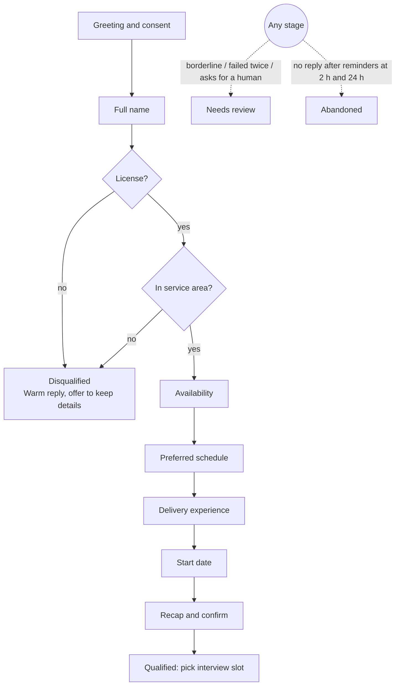

# Grupo Sazón — Candidate Screening Agent: Process Design

> Phase 1 deliverable. Detailed rules, licenses, privacy and open assumptions: [appendix](process-design-appendix.md). Recruiter side: [dashboard spec](recruiter-dashboard.md).

## Goal and principles

Today 13 recruiters make about 975 calls a week for about 1,000 applications. With 60% not answering, only about 390 screens happen, and 80% of recruiter time goes to unqualified people. The agent replaces the first phone screen with a WhatsApp-style chat.

1. **Async first.** Candidates reply when it suits them, so a missed call no longer loses a candidate.
2. **Knockouts early.** License and service area come right after the name, so nobody spends 5 minutes before being turned away.
3. **Code decides, the LLM talks.** Python owns every pass/fail rule. The LLM extracts answers and words questions; job answers are approved text.
4. **A human is always reachable.** Unclear cases go to a review queue. A rejected candidate who asks for a person gets in front of a recruiter, who can overturn the rejection.

## Conversation stages

One question at a time in this order, with answers accepted in any order. The next question is the highest-priority field still missing.

## Agent personality

**Lucía, Grupo Sazón's hiring assistant**: warm, quick and practical, like a friendly shift manager texting. She says she's automated in the first message and whenever asked. She uses *tú*, stays on topic and never judges: a disqualifying answer gets the same warm tone.

## Data fields and validation

The LLM proposes a value with the quote it came from and a confidence score. Python checks it against rules in config. A value not found in the candidate's words can't qualify or reject anyone, and an unsure value is confirmed with a yes/no first. After 2 failed attempts a field is marked `needs_review` and the conversation moves on.

| Field | Valid when | If invalid or unclear |
| --- | --- | --- |
| Full name | First name and surname | Ask for the surname; first name alone after 2 tries is accepted and flagged |
| Driver's license and vehicle | Has one for the vehicle they'd use: *Moto · Coche · Ambos · No tengo* | "Getting it soon" = no, with a note. Unsure if it covers the vehicle → review. **No license = knockout** |
| City / zone | Matches the service areas in config | Vague → ask neighbourhood or postal code. Just outside or unlisted zone → review. **Clearly outside = knockout** |
| Availability | One or more of full time, part time, weekends | "Whenever" → full time, confirmed back |
| Preferred schedule | One or more of morning, afternoon, evening, flexible | Clock times map to a slot ("from 7pm" = evening) |
| Experience | Years ≥ 0; platform known or "other" | "No" = 0, still valid. "A few months" = 0.25 |
| Start date | Today or later | "Next Monday" → a date, confirmed back. Over 60 days away is flagged |

## Edge cases

| Case | What the agent does |
| --- | --- |
| **Stops responding** | Reminders at 2 h and 24 h (23 h on WhatsApp, inside its 24 h window), then `abandoned` with the stage reached. A later reply resumes at the missing fields |
| **Invalid answer** | Acknowledge, rephrase with examples. Two tries, then `needs_review` |
| **Ambiguous answer** ("evenings, maybe weekends") | Store what's certain, ask or confirm the rest |
| **Several answers at once** | Fill every field found; never ask for something already given |
| **Switches language** (ES ↔ EN, or mixed) | Reply in the language of the latest message. Stored values don't depend on language |
| **Job questions** | Send the approved FAQ answer word for word, otherwise say a recruiter will confirm. Then return to the current question |
| **Rude or nonsense input** | One calm reply; if it continues, end politely and flag for review |
| **Shares sensitive data** (ID number, health) | Don't store it; explain it isn't needed |
| **Asks for a human** | Hand off right away. After a knockout the rejection stands, or anyone could skip it, but the request gets its own dashboard filter and they're told a person will review it |
| **Asks to stop or to delete their data** (at any point, even after the chat has closed) | Stop asking and send it to the review queue with its own reason. The candidate is told a recruiter will reply within 2 working days. After a knockout the reason stays on record |
| **Changes an earlier answer** | Take the latest value, re-validate, log the change. A valid new answer clears the review flag on that field. A corrected knockout reopens the screening |
| **Keeps refusing the recap** | After 3 replies in a row that neither confirm nor change it (`max_recap_rounds`), hand off to a recruiter (`recap_unconfirmed`) instead of repeating it |
| **Writes after the outcome** | Asking to move the interview or to talk to a person reaches the review queue, and any booking stands until a recruiter acts. After a knockout the rejection stands, as above. Anything else gets the closing message |
| **The AI provider is down** | Try the fallback, then keep the message and retry. Never counted against the candidate |

## Outcomes

Every conversation ends in one status, set by code, with a summary for the recruiter. Disqualification only comes from the two knockouts, and a person decides who is hired after the interview.

| Outcome | Triggered by | Candidate hears | Recruiter sees |
| --- | --- | --- | --- |
| **Qualified** | All fields valid, no knockout | A recap, then interview slots to book in the chat (a callback would bring back the 60% no-answer problem) | Top of the dashboard, with summary and transcript |
| **Disqualified** | No license, or clearly outside the area | A warm, honest reason and an offer to keep their details | Filtered list, kept for audit |
| **Needs review** | Borderline answer, field failed twice, asked for a human, flagged behaviour | A recruiter will contact them, with a timeframe | Review queue with the reason |
| **Abandoned** | No reply after the last reminder, or consent declined | Nothing more, or a short acknowledgement if they declined | Drop-off stage, for analytics |

## Message tone and length

Chat messages are read on a phone between deliveries: short beats complete.

- One question per message, 1–2 sentences, under about 250 characters (only the recap is longer).
- Buttons or options for closed questions when the channel supports them.
- Mirror the candidate, and never be more formal than they are.
- At most one emoji, none when disqualifying. No jargon ("screening", "criteria").

Examples:

- Opening: *¡Hola! Soy Lucía, la asistente virtual de Grupo Sazón 👋 Te hago 7 preguntas rápidas sobre el puesto de reparto (unos 3 minutos). Usamos tus respuestas solo para este proceso (aviso de privacidad: /privacy). ¿Empezamos?*
- Re-ask: *No me quedó claro — ¿qué día podrías empezar? Por ejemplo: mañana, el lunes o el 1 de marzo.*
- Disqualified: *Gracias, Marta. Para este puesto necesitamos carnet de conducir, así que ahora no podemos seguir. ¿Quieres que guardemos tus datos para futuras ofertas?*

The same flow runs on a voice call, with options said aloud and names and towns always read back ([appendix E](process-design-appendix.md#e-conversation-rules-in-detail)).
